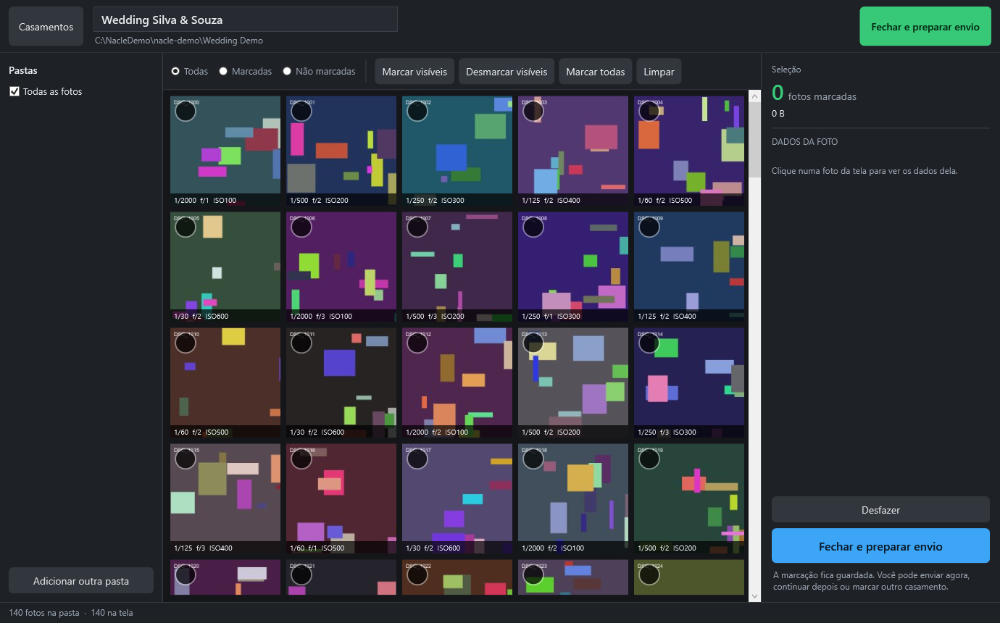
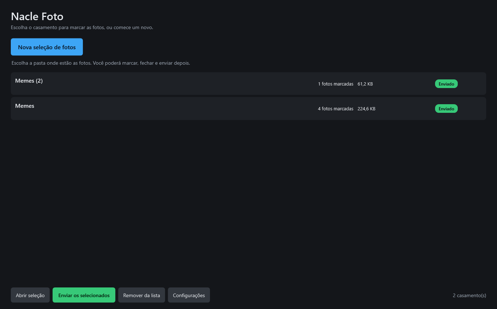
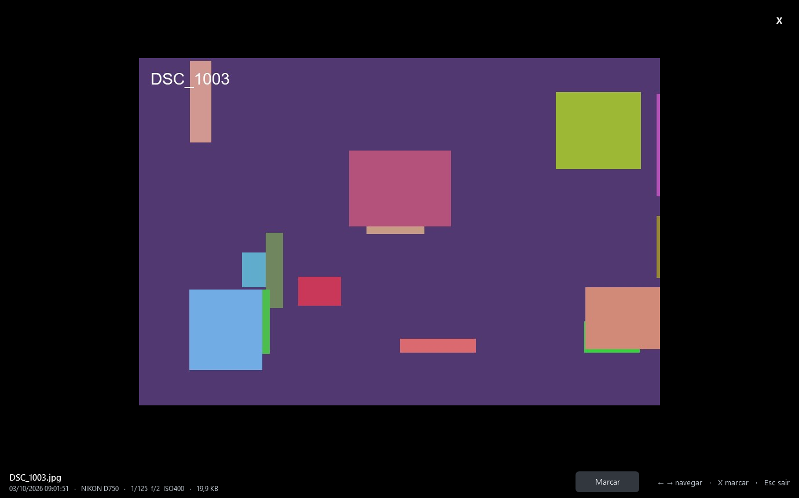
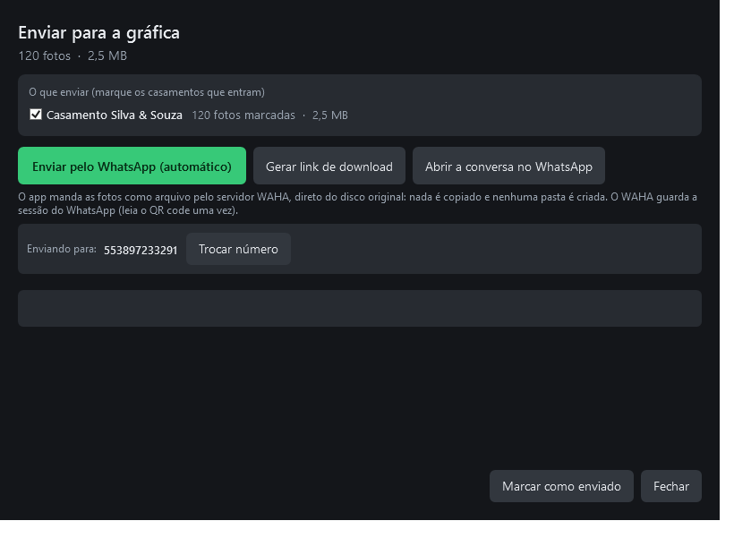
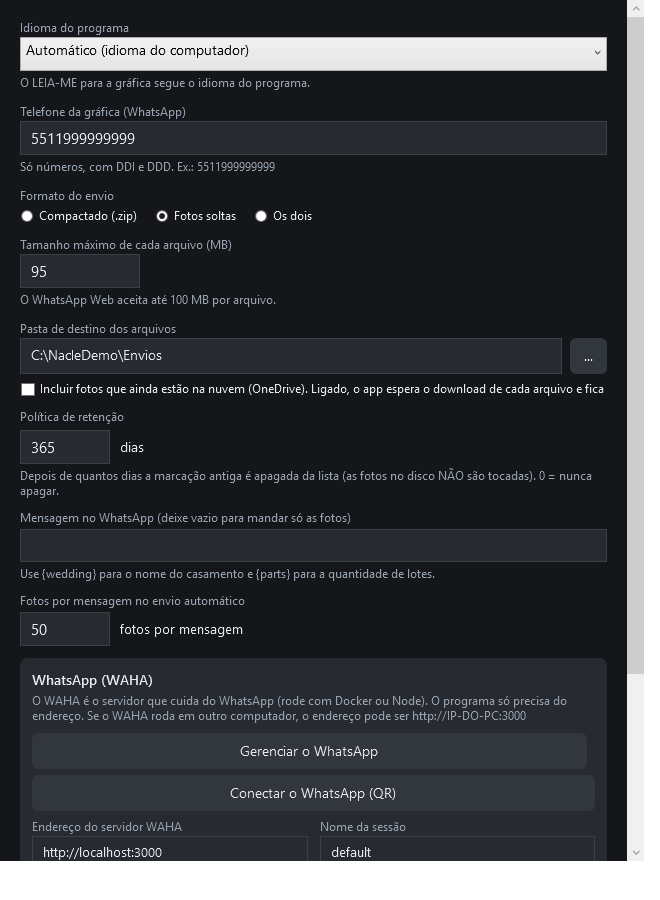
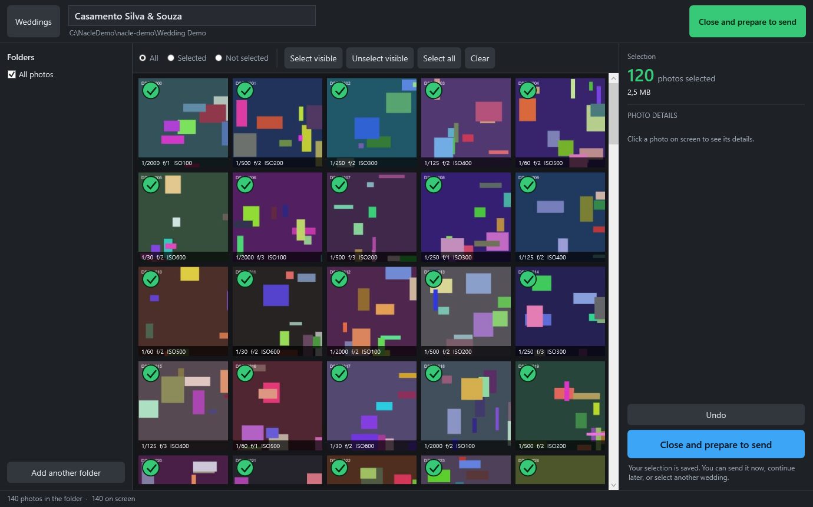
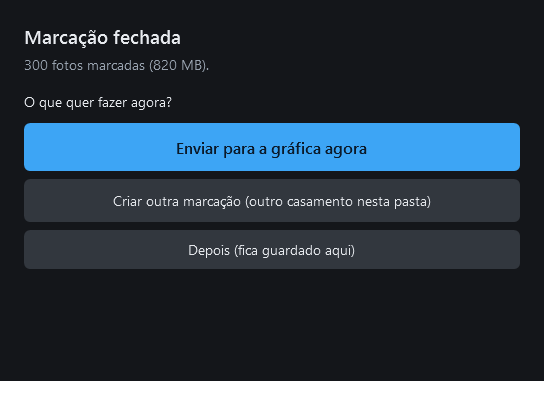
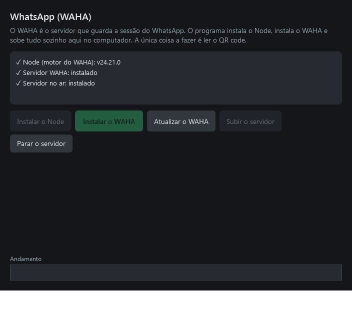

# Nacle Foto

**English** | [Português (Brasil)](docs/README-pt-BR.md)

A fast, small Windows app to **mark photos** in huge folders, **close a selection per
wedding**, and **send it to the print shop** — nothing to install, nothing to copy, no
folder created.



---

## What it does

- **Marks photos** in folders with thousands of files, showing the camera settings (EXIF)
  of each one
- **Keeps one selection per wedding** — the folder can hold many weddings at once
- **Closes the selection** and sends it: by WhatsApp, by download link, or by preparing
  the files
- **Sends the original files** — no copy, no hard link, no extra folder, original quality
- **Two languages** (Portuguese and English), following the operating system by default

---

## Install

**Copy the folder, run the .exe.** Nothing to install: the app uses the .NET Framework 4.8
that already ships with Windows 10 and 11. The whole app is about 1 MB.

1. Copy the `NacleFoto` folder to the computer (e.g. `C:\NacleFoto`)
2. Double click `NacleFoto.exe`
3. Open **Settings** and put the print shop phone number in (digits only, with country and
   area code, e.g. `5511999999999`)
4. Open **Settings → WhatsApp (WAHA) → Manage WhatsApp**, install the WhatsApp server with
   one click, then press **Start server**
5. Press **QR code** and read it with the phone (WhatsApp → Linked devices)

Full step-by-step guides:

- **[English — INSTALL.txt](docs/INSTALL.txt)**
- **[Português — COMO-INSTALAR.txt](docs/COMO-INSTALAR.txt)**

The WhatsApp server (WAHA) is downloaded by the app itself the first time, so nobody has
to type a command.

---

## Screenshots

| | |
|---|---|
|  |  |
|  |  |
|  |  |
|  |  |

---

## Architecture decisions

| Decision | Why |
|---|---|
| **C# / WPF on .NET Framework 4.8** | Runs on any Windows 10/11 **with nothing to install** (the .NET Framework is already there). ~1 MB exe. |
| **No Electron, no Python** | 150 MB of RAM and slow startup — too heavy for an old machine. |
| **WIC for images** | `BitmapImage.DecodePixelWidth` does a *scaled decode*: a thumbnail of a 24 MP photo without loading 24 MP into memory. |
| **Own EXIF parser (pure managed)** | Reads only the JPEG header → indexing 2,000 photos takes seconds, with no decoding. |
| **Thumbnail cache on disk, self-indexing** | The file name is the hash of (path, size, date): a changed file gets a new thumbnail, with no table to invalidate. |
| **Cache keyed by volume serial** | The pendrive changes letter (E: → F:) but the serial is the same → the thumbnails come back. |
| **Selection stored with relative paths** | The selection survives the pendrive changing letter. |
| **`.nproj` file saved next to the photos** | The selection travels with the photos, even between machines. |
| **Grid = rows + `UniformGrid` + `VirtualizingStackPanel`** | Native WPF virtualization: only the visible thumbnails exist on screen. |
| **Download link via sendit.sh** | No login to create the link and no login for whoever receives it. |
| **Send straight from the original files** | Nothing is copied and no folder is created — not even a hard link. |
| **The WhatsApp server runs locally** | The app installs, starts and stops it. No account, no service, no cost. |

---

## Sending by WhatsApp (WAHA)

The app talks to **WAHA**, an open-source WhatsApp API server, over HTTP on localhost. The
app takes care of the whole thing:

1. Checks whether **Node** is installed and installs it with **winget** if not
2. Installs **WAHA** (git clone + `yarn install` + build) into
   `%LOCALAPPDATA%\NacleFoto\Waha` — without Chromium (the NOWEB engine does not need it),
   saving about 150 MB
3. **Starts the server on localhost** with an API key the app generates itself
4. Shows the **QR code inside the app**: read it with the phone, once, and you are done

Everything lives in **Settings → WhatsApp (WAHA) → Manage WhatsApp**, with a live log.
The server starts by itself when the app opens and stops when the app closes.

The photos go out **as files** (not as images, so the quality is untouched), straight from
the original folder. **Nothing is copied, no folder is created.**

> The phone that reads the QR code is the account that stays paired — the app sends on
> its behalf. The print shop number is only the recipient.

---

## Project structure

```
src/NacleFoto.Core/      pure domain (net48): model, EXIF parser, .nproj, packager, SigV4, i18n
src/NacleFoto.Windows/   Windows layer (net48): WIC, cache, clipboard, Explorer integration
src/NacleFoto.App/       WPF interface (net48)
tests/NacleFoto.Tests/   xunit (net48)
tools/NacleFoto.Shots/   dev harness: generates sample photos with EXIF and renders the screens to PNG
docs/                   installation guides (PT/EN) and screenshots
```

## Build, test and run

```powershell
$env:DOTNET_CLI_TELEMETRY_OPTOUT=1
dotnet build NacleFoto.sln
dotnet test  NacleFoto.sln
dotnet run --project src/NacleFoto.App
```

The exe lands in `src/NacleFoto.App/bin/Debug/net48/NacleFoto.exe`.

To produce the folder you copy to the computer:

```powershell
powershell -ExecutionPolicy Bypass -File .\publish.ps1        # -> dist\NacleFoto
powershell -ExecutionPolicy Bypass -File .\publish.ps1 -Zip   # -> dist\NacleFoto.zip
```

## Render the screens without opening the app (development)

```powershell
dotnet run --project tools/NacleFoto.Shots
# writes PNGs to C:\NacleDemo\nacle-shots and sample photos to C:\NacleDemo\nacle-demo
```

---

## Settings

- **Language**: automatic (follows the operating system) / Portuguese / English
- **Print shop phone** (digits only, with country and area code) — e.g. `5511999999999`
- **Send format**: loose photos / compressed (.zip) / both
- **Maximum part size** (MB) — default 95
- **Destination folder** for prepared files
- **Retention policy**: after N days (default 365) old selections leave the list. The photos
  on disk are never touched.
- **Include photos that are still in the cloud** (OneDrive) — off by default
- **Download link**: where to keep the link (none / sendit.sh / synced folder)
- **Photos per message** in the automatic send — default 50

## The send flow

**Nothing is duplicated on disk and no folder is created.** The main button on the send
screen is **"Send by WhatsApp (automatic)"**:

1. **WAHA** holds the WhatsApp session: the QR code is read once
2. The app sends the photos **as files** (original quality), straight from the disk.
   **Nothing is copied, no folder is created.**
3. Progress on screen ("Sending 50 of 300...")

The other two buttons are for the manual case:

- **Generate download link** — one click: the link shows up written **and already copied**
  (Ctrl+V on WhatsApp). Default: sendit.sh (free, no login).
- **Open the WhatsApp chat** — opens the conversation on WhatsApp **Web** (not the app, so
  it does not ask every time whether you want to open the application).

### Several weddings in the same folder

One folder per week, several weddings inside. Each selection becomes an item in the list:
`dir`, `dir (2)`, `dir (3)`...
To send several at once: mark the closed ones in the list (Ctrl+click) and click
**"Send the selected ones"** — on the send screen each one has a checkbox to choose which
ones go out.

## Keyboard and mouse

**On the grid:**

| Action | How |
|---|---|
| Mark / unmark | click the **little square** (corner of the photo) or the **right mouse button** |
| Open full screen | **click the photo** or press **Enter** |
| Mark the focused photo | **Space** or **X** |
| Undo | **Ctrl+Z** |

In the zoom view: a visible **Mark/Unmark** button, `X`, `←`/`→` to navigate, `F` to fit the
screen, `Esc` to leave.

## Performance (measured)

| Situation | Time |
|---|---|
| Scan 3,000 photos (local disk) | ~85 ms |
| Read EXIF of 2,000 photos | ~6 s (in the background, 1 thread) |
| Scan `OneDrive\Images\dir` (everything in the cloud) | 24 ms (cloud files are skipped) |

Files that are still **in the cloud** (OneDrive) are ignored on purpose: opening one
triggers a download and freezes everything. You can turn it on in
*Settings → Include photos that are still in the cloud*.

## Roadmap

- [x] **F0** Foundation: solution, `.nproj` model, theme
- [x] **F1** Selection: indexing with EXIF, disk cache, virtualized grid, marking, zoom, undo
- [x] **F2** Close and send: ZIP by parts, loose photos, send screen
- [x] **F3** Channels: clipboard, `wa.me` link, download link (sendit.sh), **automatic send via WhatsApp (WAHA)**
- [x] **F4** Settings + two languages
- [ ] **F5** Explorer integration: context menu, mark straight from Explorer
- [ ] **F6** Polish: side by side compare, contact sheet, colour labels, simplified mode

## License

MIT.
